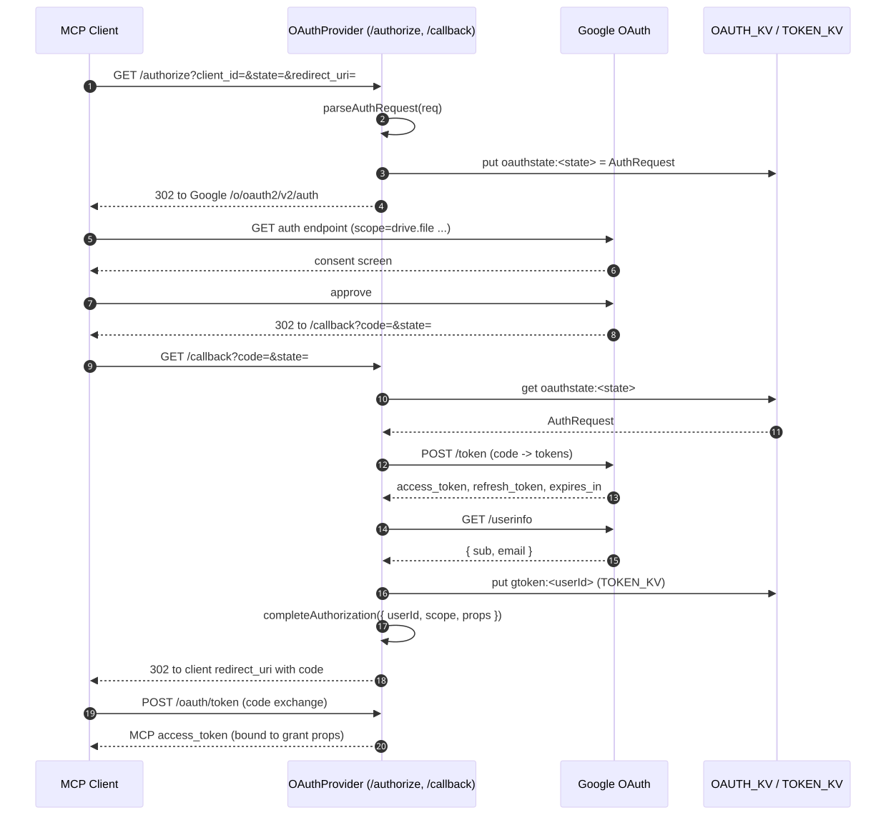

# Authentication

[← SPEC.md に戻る](./SPEC.md)

`@cloudflare/workers-oauth-provider` を Authorization Server として動かし、upstream IdP を Google にしてユーザー認証と Drive スコープ取得を兼ねる。

## フロー全体



ソース: [diagrams/oauth-sequence.mmd](./diagrams/oauth-sequence.mmd)

## 役割分担

| 役割 | 担当 |
|---|---|
| MCP クライアント向け OAuth 2.1 AS | `OAuthProvider` ([src/index.ts](../src/index.ts)) |
| クライアント承認 UI | 本サーバーの承認画面 ([src/auth/approval.ts](../src/auth/approval.ts))。クライアント名と redirect 先ホストを表示し、ブラウザ × (クライアント, redirect_uri) ごとに初回のみ出す |
| ログイン・スコープ同意 UI | upstream Google (本サーバーは独自ログイン画面を持たない) |
| Google IdP との code 交換 / userinfo 取得 | [src/auth/google.ts](../src/auth/google.ts) |
| Google access/refresh token 保管とリフレッシュ | [src/auth/tokens.ts](../src/auth/tokens.ts) |

## エンドポイント

| パス | メソッド | 役割 |
|---|---|---|
| `/authorize` | GET | OAuth リクエスト受領・検証 → state 保存 + state Cookie 発行 → (`client_id`, `redirect_uri`) が承認済みなら Google にリダイレクト、未承認なら承認画面を表示 |
| `/authorize` | POST | 承認画面の送信。state Cookie とフォームの `state` を照合 (CSRF) → 承認済み Cookie に追加 → Google にリダイレクト |
| `/callback` | GET | Google からのリダイレクト着地 → state Cookie 照合 → code 交換 → `completeAuthorization` |
| `/oauth/token` | POST | クライアントへの access token 発行 (OAuthProvider 標準) |
| `/oauth/register` | POST | Dynamic Client Registration (OAuthProvider 標準) |

## `/authorize` で拒否するリクエスト

`parseAuthRequest()` に加えて、本サーバーで以下を 400 にする:

- 未登録の `client_id`
- `redirect_uri` が無い、またはクライアント登録時の `redirect_uris` に含まれない
- `response_type` が `code` 以外
- PKCE なし、または `code_challenge_method` が `S256` 以外 (`plain` 不可)

## クライアント承認画面

`/oauth/register` (DCR) は未認証で誰でもクライアントを登録できる。承認画面なしだと、攻撃者が自分の
`redirect_uri` で登録したクライアントの `/authorize` URL を踏ませるだけで、被害者が Google で同意した結果の
認可コードが攻撃者に届いてしまう (confused deputy)。Google の同意画面には本サーバーのアプリ名しか出ないため、
被害者は気付けない。

そのため、ブラウザがまだ承認していない **`client_id` と `redirect_uri` の組** では Google に進む前に承認画面を表示する:

- 表示内容: クライアント名 (自己申告なので参考情報)、**認可コードの送信先ホスト**と `redirect_uri`、
  そのクライアントに登録されている全 `redirect_uri`
- 承認すると `COOKIE_SECRET` で HMAC 署名した `__Host-gdmcp_approved` Cookie に
  `SHA-256(client_id, redirect_uri)` を追加し、次回以降その組は承認画面を出さずに Google へ進む
- 承認を `client_id` 単位にしないのは、DCR で `redirect_uri` を複数登録したクライアントが、正規の送信先で
  承認させた後に別の送信先 (攻撃者のサーバー) へ承認画面なしで認可コードを送れてしまうため
- CSRF 対策: `GET /authorize` で発行した `__Host-gdmcp_state` Cookie とフォームの `state` が一致しないと 403
- クリックジャッキング対策: `frame-ancestors 'none'` / `X-Frame-Options: DENY`

Cookie の詳細は [data-model.md](./data-model.md#oauth-用-cookie)。

## Google から要求するスコープ

`WORKER_BASE_URL` で定義する `GOOGLE_OAUTH_SCOPES`:

```
openid
email
profile
https://www.googleapis.com/auth/drive.file
https://www.googleapis.com/auth/drive.readonly
```

- `drive.file`: **本サーバー経由で作成または明示的に開かれたファイルのみ** の作成・削除。`prepare_upload` / `complete_upload` / `delete_file` が使う
- `drive.readonly`: **ユーザーの Drive 全体** の検索・閲覧・ダウンロード。`search_files` / `get_file_metadata` / `download_file` が使う

`drive.readonly` により、接続したクライアントはユーザーの Drive 全体を読める。リスクと対策は [security.md](./security.md) を参照。

## トークンの保管

### Google access/refresh token

- 保管先: `TOKEN_KV` の `gtoken:<userId>` キー
- 値: `{ accessToken, refreshToken, expiresAt, scope }`
- リフレッシュ: `getFreshAccessToken()` が `expiresAt - 60` を過ぎていれば `refresh_token` で更新し KV を書き戻す
- 失効: Google 側で revoke されると次回リフレッシュが 4xx で失敗。ユーザー側で再度 `/authorize` する必要がある

### OAuth state

- 保管先: `OAUTH_KV` の `oauthstate:<state>` キー (TTL 10 分)
- 値: `parseAuthRequest()` が返す `AuthRequest` JSON
- 用途: `/callback` で state 検証 (CSRF 対策) + 元の OAuth リクエストを復元
- ブラウザ紐付け: 同じ値を `__Host-gdmcp_state` Cookie にも入れ、`/callback` で一致を確認する。KV の照合だけでは「攻撃者が自分の Google アカウントで得た code/state を被害者のブラウザに踏ませる」login CSRF を防げないため

### Grant (OAuthProvider 内部)

- OAuthProvider が自身で `OAUTH_KV` に grant とクライアント情報を保管
- `completeAuthorization({ userId, scope, props })` を呼ぶと、`props` が grant にバインドされ、`/mcp` への Bearer 検証時に `ctx.props` として伝搬される
- McpAgent はそれを `_init` で受け取り、`getMcpAuthContext().props` から `userId` / `email` を読める

## props の中身

```ts
interface UserProps {
  userId: string;   // Google "sub" claim
  email: string;
}
```

`userId` がそのまま `TOKEN_KV` のキー、`UPLOAD_KV` レコードの `userId` フィールド、JWT の `sub` クレームになる。これで MCP・Upload handler・Google アカウントが 1 本に紐づく。

## Google Cloud Console 側の設定

1. OAuth 2.0 クライアント ID (種別: Web application) を作成
2. 承認済みリダイレクト URI に `{WORKER_BASE_URL}/callback` を登録 (ローカル開発時は `http://localhost:8787/callback` も追加)
3. OAuth 同意画面でスコープ `.../auth/drive.file` と `.../auth/drive.readonly` を有効化、テストモードならテストユーザーを追加
4. 取得した `client_id` / `client_secret` を `wrangler secret put` で投入

## 再認可が必要なタイミング

- ユーザーが Google アカウント側で本アプリの権限を取り消した
- `refresh_token` が期限超過 (Google は 6 ヶ月未使用などで失効)
- `GOOGLE_OAUTH_SCOPES` を増やしたとき (旧 grant では新スコープが取れない)
